<picture>
  <source media="(prefers-color-scheme: dark)" srcset="assets/hero-dark.svg">
  
</picture>

  
  
  

  <a href="https://maoyangui.github.io/m-ui/"><b>m-ui docs</b></a> ·
  <a href="https://maoyangui.github.io/m-ui/demo/">Live demo</a> ·
  <a href="https://maoyangui.github.io/godusevpn/"><b>佛跳墙</b></a> ·
  <a href="https://maoyangui.github.io/godusevpn/docs.html">Client docs</a>

 

<a href="https://github.com/Maoyangui/m-ui">
  <picture>
    <source media="(prefers-color-scheme: dark)" srcset="assets/m-ui-dark.svg">
    
  </picture>
</a>

<a href="https://github.com/Maoyangui/godusevpn">
  <picture>
    <source media="(prefers-color-scheme: dark)" srcset="assets/godusevpn-dark.svg">
    
  </picture>
</a>

  

<picture>
  <source media="(prefers-color-scheme: dark)" srcset="assets/principles-dark.svg">
  
</picture>

<picture>
  <source media="(prefers-color-scheme: dark)" srcset="assets/stack-dark.svg">
  
</picture>

冒央会社 · Maoyang Inc. — built in the open, GPL-3.0

